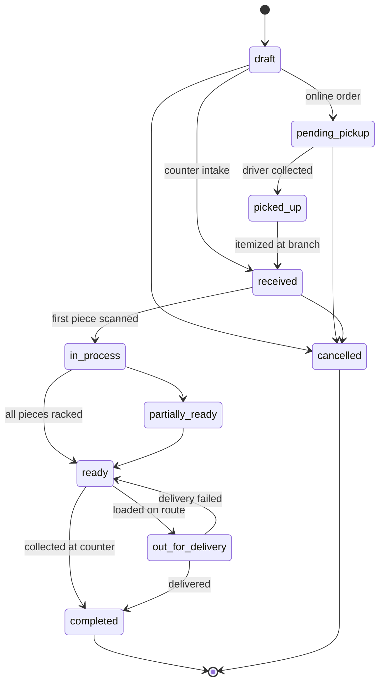
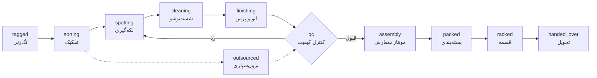
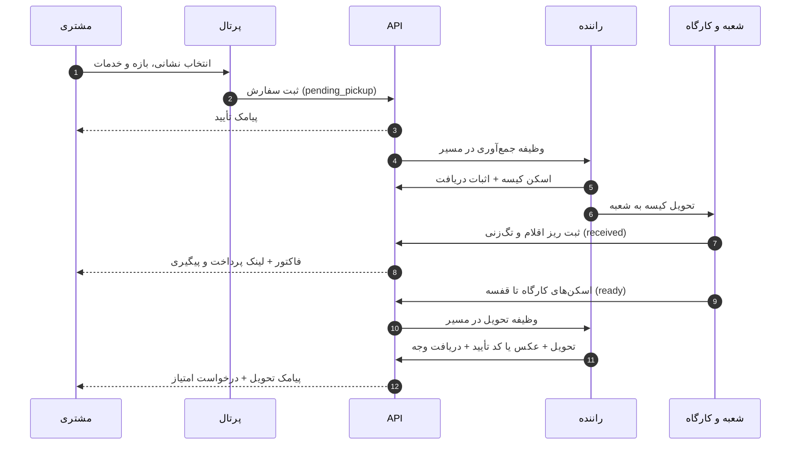
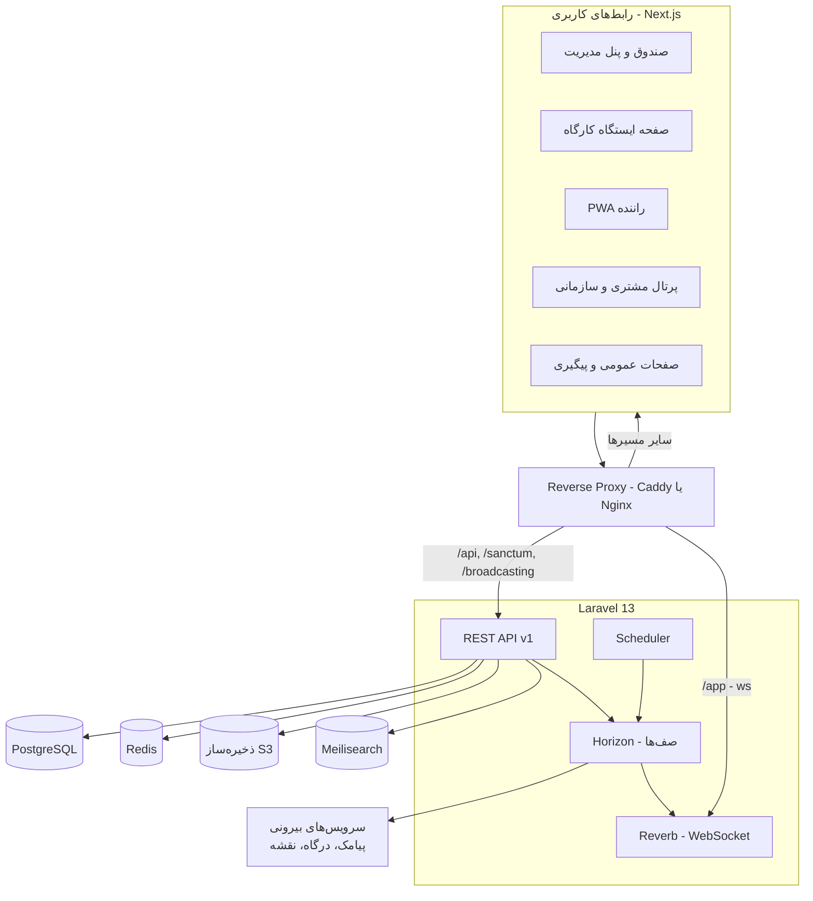
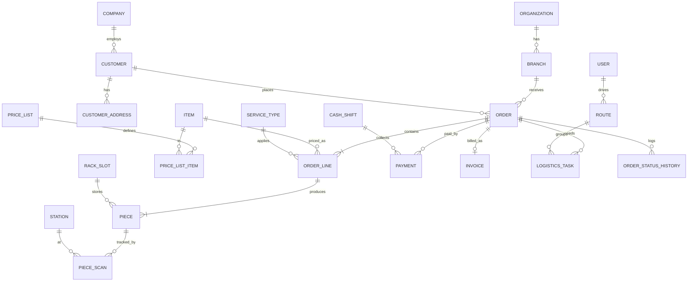
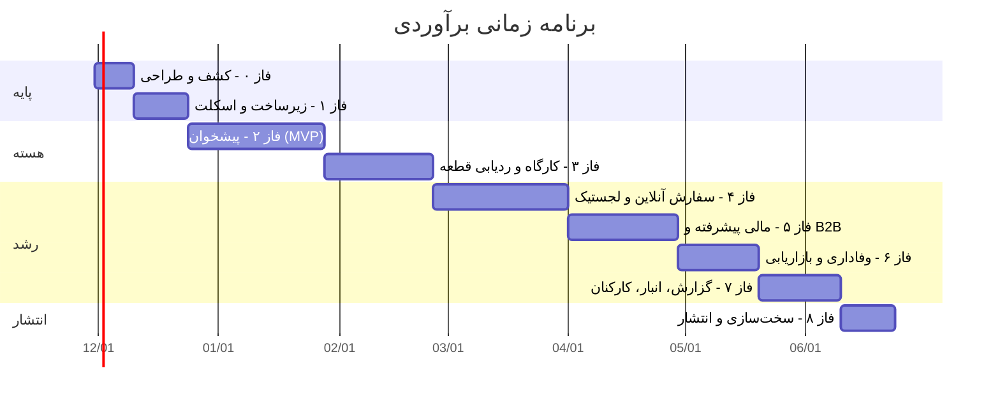

# نقشه‌راه سامانه جامع مدیریت خشکشویی

سند مرجع کل مسیر پروژه: از بررسی نمونه‌های جهانی تا معماری، مدل داده، فازبندی و معیارهای پذیرش.

| مشخصه | مقدار |
|---|---|
| تاریخ تدوین | ۲ آذر ۱۴۰۵ (2026-11-23) |
| وضعیت | پیش‌نویس نسخه ۱ — منتظر تأیید تصمیم‌های باز بخش ۱۶ |
| پشته فنی | Laravel 13 (API) + Next.js 16 / React 19 (SPA) + Ant Design 6 |
| زبان اصلی محصول | فارسی، راست‌به‌چپ، تقویم جلالی — آماده چندزبانه |

## فهرست

1. [خلاصه و فرض‌ها](#۱-خلاصه-و-فرضها)
2. [بررسی نمونه‌های برتر دنیا](#۲-بررسی-نمونههای-برتر-دنیا)
3. [چشم‌انداز محصول و نقش‌ها](#۳-چشمانداز-محصول-و-نقشها)
4. [نقشه ماژول‌ها و اولویت‌ها](#۴-نقشه-ماژولها-و-اولویتها)
5. [جریان‌های اصلی کسب‌وکار](#۵-جریانهای-اصلی-کسبوکار)
6. [معماری فنی](#۶-معماری-فنی)
7. [پشته فنی و نسخه‌ها](#۷-پشته-فنی-و-نسخهها)
8. [مدل داده](#۸-مدل-داده)
9. [طراحی API](#۹-طراحی-api)
10. [ساختار بک‌اند](#۱۰-ساختار-بکاند-laravel)
11. [ساختار فرانت‌اند](#۱۱-ساختار-فرانتاند-nextjs--ant-design)
12. [سخت‌افزار، چاپ و آفلاین](#۱۲-سختافزار-چاپ-و-آفلاین)
13. [امنیت و سطوح دسترسی](#۱۳-امنیت-و-سطوح-دسترسی)
14. [کیفیت، تست و استقرار](#۱۴-کیفیت-تست-و-استقرار)
15. [فازبندی و مایلستون‌ها](#۱۵-فازبندی-و-مایلستونها)
16. [تصمیم‌های باز و ریسک‌ها](#۱۶-تصمیمهای-باز-و-ریسکها)
17. [شاخص‌های موفقیت](#۱۷-شاخصهای-موفقیت)
18. [منابع](#۱۸-منابع)

---

## ۱. خلاصه و فرض‌ها

هدف ساخت یک سامانه یکپارچه است که کل چرخه خشکشویی را پوشش دهد: پذیرش در پیشخوان، ردیابی تک‌تک قطعات در کارگاه، جمع‌آوری و تحویل درب منزل، مالی و مشتریان سازمانی، وفاداری و بازاریابی، و گزارش‌های مدیریتی.

بررسی بازار نشان می‌دهد محصولات برتر دنیا روی پنج ستون ایستاده‌اند و این سند هم بر همین پنج ستون بنا شده است:

1. **پذیرش سریع قطعه‌محور** — صندوق لمسی با قیمت‌گذاری قطعه × خدمت، اضافه‌بها، عکس و یادداشت عیب.
2. **ردیابی بارکدی هر قطعه** — از تگ‌زنی تا مونتاژ سفارش و قفسه؛ هیچ قطعه‌ای گم نمی‌شود.
3. **جمع‌آوری و تحویل** — سفارش آنلاین، محدوده سرویس، بازه زمانی، مسیر راننده، اثبات تحویل.
4. **ارتباط خودکار با مشتری** — پیامک/پوش در هر تغییر وضعیت، یادآور، کمپین.
5. **مالی و گزارش** — صندوق، فاکتور، حساب اعتباری سازمانی، داشبورد لحظه‌ای.

### فرض‌هایی که این سند بر آن‌ها بنا شده

| # | فرض | اگر نادرست باشد |
|---|---|---|
| ۱ | منظور از «نسکت» همان **Next.js** است (نه NestJS)؛ چون بک‌اند Laravel است و NestJS نقش تکراری پیدا می‌کرد. | فقط بخش ۱۱ عوض می‌شود. |
| ۲ | بازار هدف اول **ایران** است: فارسی، ریال/تومان، جلالی، درگاه و پیامک داخلی. | آداپترهای بخش ۶ـ۷ عوض می‌شوند؛ هسته دست نمی‌خورد. |
| ۳ | شروع با **یک کسب‌وکار چندشعبه** است، ولی ستون `organization_id` از روز اول در همه جداول هست تا تبدیل به SaaS بازنویسی نخواهد. | بخش ۶ـ۶ |
| ۴ | اپ مشتری و راننده در گام اول **PWA** است، نه اپ بومی. | فاز ۹ |

---

## ۲. بررسی نمونه‌های برتر دنیا

اطلاعات این بخش از صفحات رسمی محصولات و فهرست‌های مقایسه‌ای (Capterra، G2، SourceForge و …) گرفته شده و ادعاهای فروشندگان مستقل راستی‌آزمایی نشده است. قیمت‌ها نقطه شروع اعلامی هستند.

### ۲ـ۱. پلتفرم‌های مدیریتی

| محصول | جایگاه | قابلیت‌های شاخص | درس برای ما |
|---|---|---|---|
| **CleanCloud** | جامع‌ترین پلتفرم ابری؛ خشکشویی + لاندری + جمع‌آوری و تحویل. از حدود ۴۹ دلار در ماه | صندوق چندسکویی؛ اعلان ایمیل/پیامک/پوش/واتس‌اپ؛ یادآور خودکار سفارش‌های مانده؛ محصول وزنی؛ اضافه‌بها و یادداشت عیب و لکه؛ عکس قطعه؛ چاپ رسید، تگ و برچسب حرارتی (heat seal)؛ مونتاژ کمکی و خودکار با نوار نقاله؛ محل قفسه؛ تفکیک قبض؛ چند لیست قیمت؛ فاکتور گروهی ماهانه؛ اشتراک با هزینه مازاد؛ اپ راننده با عکس، امضا، چت و کار آفلاین؛ بهینه‌ساز مسیر تا ۱۵۰ توقف؛ محدوده جغرافیایی (geofence)؛ جمع‌آوری دوره‌ای با یادآور روز قبل؛ حالت «کارگاه مرکزی» برای چند شعبه؛ ردیابی برون‌سپاری؛ قفل‌های هوشمند (locker)؛ قوانین بازاریابی خودکار؛ درخواست نظر؛ ورود و خروج و حقوق کارکنان؛ قفل پین | الگوی اصلی دامنه و وسعت ماژول‌ها |
| **SMRT Systems** | ابری، ساخته‌شده حول کل چرخه سفارش؛ مناسب کارگاه‌های حرفه‌ای | صندوق؛ جمع‌آوری و تحویل؛ مونتاژ و اتو با نوار نقاله (Metalprogetti)؛ ردیابی تک‌قطعه؛ سنجش بهره‌وری کارکنان؛ شاخص‌های سفارشی؛ عکس‌برداری از اقلام؛ صورت‌حساب و پرداخت دوره‌ای؛ راه‌حل‌های صنفی (هتل، یونیفرم، کوتور، مرمت)؛ API مستند | عمق کارگاه و بهره‌وری ایستگاه‌ها |
| **Cents** | همه‌کاره برای لاندرومت و «شست‌وشو و تا» (wash & fold). از ۸۹ دلار در ماه | صندوق وزنی؛ پیام وضعیت به ۱۰ زبان؛ سفارش آنلاین؛ مسیر و راننده؛ کارت ساعت و چک‌لیست روزانه کارکنان؛ انبار؛ فاکتور تجاری؛ وفاداری و عضویت ماهانه؛ اتصال به ماشین‌ها و شروع از راه دور؛ داشبورد لحظه‌ای؛ «پذیرشگر هوش مصنوعی» | مدل وزنی، عضویت، وظایف روزانه کارکنان |
| **Xplor Spot** | قدیمی و جاافتاده در خشکشویی‌های بزرگ | قطعات بارکددار؛ تحویل جزئی سفارش؛ چند شعبه؛ کار آفلاین؛ مجموعه تحویل برای مسیرها؛ کوپن و پاداش؛ پشتیبانی هتل؛ گزارش تفصیلی تولید و حسابداری | تحویل جزئی و کار آفلاین ضروری‌اند |
| **Starchup** | صندوق + لجستیک خشکشویی و وزنی | مونتاژ کمکی و خودکار با سه سامانه نقاله رایج؛ بهینه‌سازی مسیر، ردیابی راننده، به‌روزرسانی لحظه‌ای توقف‌ها | رابط مونتاژ باید مستقل از سخت‌افزار باشد |
| **Quick Dry Cleaning (QDC)** | تک‌شعبه تا فرنچایز؛ ۱۵۰۰+ شعبه در ۱۹+ کشور | ردیابی وضعیت قطعه؛ ربات واتس‌اپ برای اعلان و پرداخت؛ اپ با برند مشتری (white-label)؛ حسابداری داخلی؛ پلن رایگان دائمی و قیمت‌گذاری بر اساس سفارش | کانال پیام‌رسان بومی؛ مدل فرنچایز |
| **Geelus** | ارزان و ساده؛ خشکشویی + خیاطی و تعمیرات | چند شعبه و چند صندوق؛ نوبت‌دهی؛ جمع‌آوری و تحویل؛ وفاداری با پیامک و ایمیل | خدمات خیاطی/تعمیرات و سادگی راه‌اندازی |
| **WinCleaners** | ویندوزی سنتی با فناوری‌های شناسایی | برچسب حرارتی بارکددار؛ جاکلیدی QR مشتری؛ رسید QR؛ رابط مونتاژ خودکار؛ شناسایی بیومتریک؛ اپ بررسی وضعیت | شناسایی سریع مشتری با QR |
| **Curbside Laundries** | لاندرومت با تمرکز بر تحویل | صندوق وزنی؛ وب‌اپ زمان‌بندی جمع‌آوری؛ اعلان «آماده شد» و «راننده در راه است»؛ سایت بهینه برای جست‌وجو | پیام «راننده در راه است» |

### ۲ـ۲. لاندری صنعتی و ملحفه (B2B)

| نمونه | قابلیت‌های شاخص | درس برای ما |
|---|---|---|
| **HID ACUITY** (ردیابی RFID منسوجات) | کنترل تک‌قلم برای اقلام مشتری و اجاره‌ای؛ پرتال وب مشتری سازمانی؛ بهینه‌سازی سطح موجودی پایه (PAR)؛ شمارش سریع کثیف/تمیز | مدل «حواله ورود و خروج با شمارش» و موجودی ملحفه برای هتل و بیمارستان |
| **Smart Laundry Logistics** | تگ حرارتی دائمی برای مشتریان سازمانی تکراری؛ تگ کاغذی موقت برای مشتری گذری | دو نوع تگ در مدل داده پیش‌بینی شود |

### ۲ـ۳. خشکشویی‌های آنلاین مصرف‌کننده (تجربه مشتری)

| نمونه | الگوی شاخص | درس برای ما |
|---|---|---|
| **Rinse** | پرداخت موردی + اشتراک ماهانه با تخفیف؛ تحویل روز بعد رایگان برای مشترکان | پلن اشتراک با سهمیه و مزیت تحویل |
| **Laundryheap** | تحویل ۲۴ ساعته؛ جمع‌آوری و تحویل رایگان | سطوح زمان تحویل (عادی/فوری) با قیمت متفاوت |
| **Londr** | جمع‌آوری هفتگی؛ کسر وجه روز قبل؛ توقف یا لغو اشتراک در اپ | مدیریت اشتراک به‌دست خود مشتری |

### ۲ـ۴. نمونه‌های ایرانی

| نمونه | نوع | قابلیت‌های اعلام‌شده |
|---|---|---|
| **آبان** | نرم‌افزار مدیریتی تحت وب | صندوق، کارگاه، اپ مدیریت، سفارش آنلاین و «سفیر»، اتصال به کارت‌خوان، خروجی اکسل و PDF |
| **اروم پشتیبان سیستم** | نرم‌افزار مدیریتی | سفارش از وب و اپ، زیرکد برای گروه‌بندی، اتصال به کارت‌خوان، ثبت‌نام آنلاین مشتری |
| **پاکلین، واش‌لین، تک‌واش، اکتیوکلینرز** | خشکشویی آنلاین (تهران) | سفارش از اپ یا وب‌اپ، دریافت و تحویل درب منزل، خدمات ۲۴ ساعته؛ پاکلین دستیار هوش مصنوعی هم دارد |

### ۲ـ۵. جمع‌بندی: حداقل‌های لازم و مزیت رقابتی ما

حداقل‌هایی که هر محصول جدی دارد و ما هم باید داشته باشیم: دسترسی ابری و چندشعبه، صندوق قطعه‌محور، بارکد روی هر قطعه، مونتاژ سفارش، جمع‌آوری و تحویل با اپ راننده و اثبات تحویل، پرتال مشتری، اعلان خودکار، گزارش درآمد و بهره‌وری، حساب اعتباری و صورت‌حساب دوره‌ای.

فرصت‌هایی که در نمونه‌های بررسی‌شده کم‌رنگ است و مزیت ما می‌شود:

- **فارسی‌بودن واقعی** در کنار عمق جهانی: راست‌به‌چپ، جلالی، تومان، کارت‌خوان، درگاه و پیامک داخلی — همراه با ردیابی تک‌قطعه، کارگاه مرکزی، لجستیک و B2B در یک محصول.
- **لینک پیگیری عمومی** در پیامک (بدون نصب اپ و بدون ورود) با خط زمانی سفارش.
- **صندوق مقاوم به قطعی اینترنت** با صف همگام‌سازی.
- **رابط‌های مستقل از سخت‌افزار و سرویس‌دهنده** (چاپگر، ترازو، درگاه، پیامک، نقشه) تا قفل یک تأمین‌کننده نشویم.
- **API و وب‌هوک باز** از روز اول.

---

## ۳. چشم‌انداز محصول و نقش‌ها

### ۳ـ۱. مدل‌های کسب‌وکاری که پشتیبانی می‌شوند

- خشکشویی حضوری با پیشخوان (یک یا چند شعبه)
- چند شعبه پذیرش + یک کارگاه مرکزی (جابه‌جایی کیسه بین شعبه و کارگاه)
- سفارش آنلاین با جمع‌آوری و تحویل درب منزل
- شست‌وشوی وزنی (کیلویی) و «شست‌وشو و تا»
- مشتریان سازمانی: هتل، رستوران، کلینیک، باشگاه، آرایشگاه (قرارداد، حواله، صورت‌حساب ماهانه)
- خدمات جانبی: فرش و موکت، پرده، پتو، چرم و جیر، کفش، خیاطی و تعمیرات (داخلی یا برون‌سپاری)

### ۳ـ۲. نقش‌ها

| نقش | کار اصلی | رابط کاربری |
|---|---|---|
| مالک / مدیر کل | نظارت، قیمت‌گذاری، گزارش، تنظیمات | پنل مدیریت |
| مدیر شعبه | عملیات روزانه شعبه، صندوق، کارکنان | پنل مدیریت |
| پذیرش / صندوق‌دار | ثبت سفارش، دریافت وجه، تحویل | صندوق (POS) لمسی |
| اپراتور کارگاه | تفکیک و تگ، لکه‌گیری، شست‌وشو، اتو، کنترل کیفیت، مونتاژ، قفسه | صفحه ایستگاه (کیوسک) |
| راننده / پیک | جمع‌آوری و تحویل، دریافت وجه | PWA راننده |
| حسابدار | فاکتور، مطالبات، هزینه، خروجی حسابداری | پنل مدیریت |
| پشتیبان | پاسخ به مشتری، شکایات، ثبت سفارش تلفنی | پنل مدیریت |
| مشتری | سفارش، پیگیری، پرداخت، اشتراک | پرتال مشتری (PWA) |
| کاربر سازمانی | ثبت درخواست، تأیید حواله، مشاهده صورت‌حساب | پرتال سازمانی |

### ۳ـ۳. اصول راهنما

1. **هر قطعه یک هویت دارد.** هر قطعه (یا کیسه در مدل وزنی) کد یکتا می‌گیرد و هر جابه‌جایی‌اش ثبت می‌شود.
2. **اول اسکن.** هر عملیات کارگاه و تحویل با اسکن بارکد یا QR انجام می‌شود، نه جست‌وجوی دستی.
3. **تاریخچه حذف‌نشدنی.** تغییر وضعیت، ویرایش سفارش و تراکنش مالی فقط اضافه می‌شوند؛ اصلاح با سند معکوس.
4. **API-اول.** هر قابلیت ابتدا در API و مستندات OpenAPI می‌آید؛ همه رابط‌ها مصرف‌کننده همان API هستند.
5. **مونولیت ماژولار.** یک برنامه Laravel با ماژول‌های دامنه‌ای جدا؛ بدون میکروسرویس تا وقتی نیاز واقعی نباشد.
6. **آداپتر برای هر سرویس بیرونی.** درگاه، پیامک، نقشه، چاپگر پشت یک قرارداد (interface) قرار می‌گیرند.
7. **سه کلیک تا ثبت سفارش.** صندوق باید در ساعت شلوغی سریع‌تر از قبض دستی باشد.

---

## ۴. نقشه ماژول‌ها و اولویت‌ها

سطح اولویت: **M** = نسخه اولیه (MVP)، **۱** = نسخه ۱، **۲** = نسخه ۲، **۳** = آینده.

### ۴ـ۱. هویت و سازمان

| قابلیت | اولویت |
|---|---|
| ورود کارکنان با نام کاربری و رمز؛ تعویض سریع کاربر در صندوق با پین | M |
| نقش‌ها و مجوزهای جزئی؛ محدودسازی به شعبه | M |
| سازمان، شعبه (پذیرش / کارگاه / ترکیبی)، ساعات کاری، تعطیلات جلالی | M |
| تنظیمات: مالیات، شماره‌گذاری قبض، قالب رسید و تگ، واحد پول | M |
| لاگ فعالیت کاربران (چه کسی، چه چیزی، کی) | M |
| ورود مشتری با کد یک‌بارمصرف پیامکی | ۱ |
| ورود دومرحله‌ای برای مالک و حسابدار | ۱ |
| پرچم قابلیت (feature flag) به‌ازای سازمان | ۲ |

### ۴ـ۲. کاتالوگ و قیمت‌گذاری

| قابلیت | اولویت |
|---|---|
| نوع خدمت (خشکشویی، شست‌وشو، فقط اتو، لکه‌بری، وزنی و …) | M |
| دسته و قلم (پیراهن، کت، پتو …) با آیکون و رنگ برای صندوق لمسی | M |
| ماتریس قیمت قلم × خدمت؛ واحد: عدد / کیلو / متر مربع | M |
| اضافه‌بها: جنس (ابریشم، چرم)، پلیسه، سایز، لکه سنگین؛ ثابت یا درصدی | M |
| سطوح زمان تحویل: عادی / فوری / همان‌روز با ضریب قیمت | M |
| چند لیست قیمت: عمومی، شعبه، سازمانی، ویژه | ۱ |
| بسته و پکیج (مثلاً کت‌وشلوار = دو قطعه با یک قیمت) | ۱ |
| ورود و خروج لیست قیمت با اکسل | ۱ |

### ۴ـ۳. مشتریان (CRM)

| قابلیت | اولویت |
|---|---|
| جست‌وجوی آنی با موبایل / نام / شماره قبض؛ ثبت سریع مشتری | M |
| پروفایل، چند نشانی با موقعیت نقشه، یادداشت و هشدار | M |
| ترجیحات: آهار، آویز یا تا، خط اتو، حساسیت به شوینده، بسته‌بندی | ۱ |
| کیف پول و اعتبار؛ تاریخچه سفارش و پرداخت | ۱ |
| برچسب و بخش‌بندی؛ لیست سیاه | ۱ |
| شکایت و تیکت؛ امتیازدهی پس از تحویل | ۱ |
| تحلیل RFM و ریزش مشتری | ۲ |

### ۴ـ۴. صندوق و پذیرش (POS)

| قابلیت | اولویت |
|---|---|
| ثبت سفارش لمسی: انتخاب قلم و خدمت، تعداد، اضافه‌بها، یادداشت | M |
| مشخصات قطعه: رنگ، برند، طرح، عیب و لکه (انتخابی از فهرست آماده) | M |
| محاسبه خودکار موعد تحویل از سطح زمان و تقویم کاری | M |
| چاپ رسید مشتری و تگ بارکددار هر قطعه | M |
| پرداخت: نقد، کارت‌خوان، پیش‌پرداخت، پرداخت هنگام تحویل، چندروشه | M |
| تحویل حضوری: اسکن رسید ← نمایش محل قفسه ← تحویل کامل یا جزئی | M |
| شیفت صندوق: باز کردن، بستن، مغایرت‌گیری، دریافت و پرداخت متفرقه | M |
| تخفیف دستی با سقف مجوز؛ کد تخفیف | M |
| ویرایش و لغو سفارش با ثبت دلیل و مجوز | M |
| عکس قطعه و عیب‌ها | ۱ |
| تفکیک خودکار قبض بر اساس نوع خدمت | ۱ |
| شست‌وشوی مجدد (redo) با اتصال به سفارش اصلی | ۱ |
| یادآور خودکار سفارش‌های تحویل‌نگرفته | ۱ |
| ترازوی متصل برای سفارش وزنی | ۲ |
| اتصال مستقیم به کارت‌خوان (ارسال مبلغ) | ۲ |
| حالت آفلاین کامل با صف همگام‌سازی | ۲ |

### ۴ـ۵. کارگاه و تولید

| قابلیت | اولویت |
|---|---|
| جریان وضعیت ساده سفارش: دریافت ← در حال انجام ← آماده ← تحویل | M |
| تخصیص محل قفسه و جست‌وجوی محل | M |
| ایستگاه‌های قابل تعریف و اسکن قطعه در هر ایستگاه | ۱ |
| تابلوی تولید: موعد امروز، عقب‌افتاده، فوری — به‌روزرسانی لحظه‌ای | ۱ |
| مونتاژ سفارش: اسکن قطعات تا تکمیل، هشدار قطعه جامانده | ۱ |
| کنترل کیفیت و چرخه دوباره‌کاری | ۱ |
| جابه‌جایی شعبه ↔ کارگاه با بارنامه و شمارش کیسه | ۱ |
| برون‌سپاری (فرش، چرم، خیاطی) با پیگیری رفت و برگشت | ۱ |
| پرونده خسارت و مفقودی | ۱ |
| دسته‌بندی بار (batch) و تخصیص به ماشین | ۲ |
| بهره‌وری اپراتور: قطعه در ساعت به‌تفکیک ایستگاه | ۲ |
| ثبت ماشین‌ها، سرویس و خرابی | ۲ |
| اتصال به نوار نقاله مونتاژ خودکار | ۳ |

### ۴ـ۶. جمع‌آوری و تحویل (لجستیک)

| قابلیت | اولویت |
|---|---|
| محدوده سرویس روی نقشه (چندضلعی)، هزینه ارسال، حداقل سفارش | ۱ |
| بازه‌های زمانی با ظرفیت؛ رزرو بازه | ۱ |
| وظیفه جمع‌آوری و تحویل؛ تخصیص به راننده | ۱ |
| ساخت مسیر روزانه و چینش توقف‌ها (دستی + پیشنهاد خودکار) | ۱ |
| PWA راننده: مسیر امروز، مسیریابی، اسکن کیسه، دریافت وجه | ۱ |
| اثبات تحویل: عکس، امضا یا کد تأیید | ۱ |
| پیام «راننده در راه است» و موقعیت زنده راننده | ۲ |
| جمع‌آوری دوره‌ای (هفتگی) با یادآور روز قبل | ۲ |
| بهینه‌سازی مسیر با موتور مسیریابی | ۲ |
| انعام راننده؛ کارمزد و تسویه راننده | ۲ |
| پیک‌های شخص ثالث؛ قفل هوشمند (locker) | ۳ |

### ۴ـ۷. پرتال و اپ مشتری

| قابلیت | اولویت |
|---|---|
| لینک پیگیری عمومی سفارش در پیامک (بدون ورود) | M |
| ثبت سفارش آنلاین: نشانی، بازه، خدمات یا «راننده اقلام را ثبت کند» | ۱ |
| خط زمانی سفارش، فاکتور، پرداخت آنلاین | ۱ |
| مدیریت نشانی‌ها و ترجیحات؛ تکرار سفارش قبلی | ۱ |
| نصب‌پذیر (PWA) با اعلان پوش | ۱ |
| کیف پول، اشتراک، کد معرف، امتیاز | ۲ |
| گفت‌وگو با پشتیبانی | ۲ |
| اپ بومی اندروید و iOS | ۳ |

### ۴ـ۸. مالی

| قابلیت | اولویت |
|---|---|
| ثبت پرداخت و بازپرداخت؛ وضعیت پرداخت سفارش | M |
| گزارش روزانه صندوق و بستن روز | M |
| فاکتور با مالیات بر ارزش افزوده؛ خروجی PDF | ۱ |
| درگاه پرداخت آنلاین و لینک پرداخت در پیامک | ۱ |
| دفتر کیف پول مشتری | ۱ |
| حساب اعتباری سازمانی: سقف اعتبار، صورت‌حساب دوره‌ای، فاکتور گروهی | ۲ |
| سن مطالبات؛ هزینه‌ها؛ کارمزد کارکنان و رانندگان | ۲ |
| خروجی برای نرم‌افزار حسابداری | ۲ |
| اتصال به سامانه مودیان | ۳ |

### ۴ـ۹. مشتریان سازمانی (B2B)

| قابلیت | اولویت |
|---|---|
| حساب سازمانی، واحدها و مراکز هزینه، کاربران مجاز | ۲ |
| لیست قیمت قراردادی؛ قیمت عددی یا وزنی | ۲ |
| حواله ورود و خروج با شمارش و تأیید دوطرفه؛ ثبت مغایرت | ۲ |
| پرتال سازمانی: درخواست جمع‌آوری، حواله‌ها، صورت‌حساب | ۲ |
| موجودی ملحفه و سطح پایه (PAR)؛ تگ دائمی؛ RFID | ۳ |

### ۴ـ۱۰. وفاداری و بازاریابی

| قابلیت | اولویت |
|---|---|
| کد تخفیف (درصدی، مبلغی، اولین سفارش، سقف استفاده) | M |
| امتیاز وفاداری: کسب و خرج؛ سطح‌بندی مشتری | ۲ |
| کد معرف با پاداش دوطرفه | ۲ |
| پلن اشتراک ماهانه با سهمیه و هزینه مازاد | ۲ |
| کمپین پیامکی بر اساس بخش مشتریان | ۲ |
| قوانین خودکار: بازگشت مشتری غیرفعال، تولد، درخواست نظر | ۲ |
| کارت هدیه | ۳ |

### ۴ـ۱۱. اعلان‌ها

| قابلیت | اولویت |
|---|---|
| پیامک رویدادمحور: ثبت، آماده شد، تحویل شد | M |
| قالب‌های قابل ویرایش با متغیر؛ لاگ ارسال و وضعیت تحویل | M |
| اعلان درون‌برنامه‌ای و لحظه‌ای برای کارکنان | ۱ |
| پوش وب؛ ایمیل؛ ترجیحات مشتری و ساعات سکوت | ۱ |
| پیام‌رسان‌ها (واتس‌اپ، تلگرام، بله و مشابه) | ۳ |

### ۴ـ۱۲. گزارش و داشبورد

| قابلیت | اولویت |
|---|---|
| داشبورد امروز: سفارش، درآمد، موعدها، عقب‌افتاده‌ها | M |
| فروش به‌تفکیک خدمت، قلم، شعبه، کاربر، کانال؛ خروجی اکسل | M |
| زمان چرخه و نرخ تحویل به‌موقع؛ کار در جریان کارگاه | ۱ |
| اثربخشی تخفیف؛ عملکرد مسیر و راننده | ۲ |
| ماندگاری و بازگشت مشتری (cohort)؛ سن مطالبات | ۲ |
| گزارش زمان‌بندی‌شده به ایمیل یا پیام‌رسان | ۲ |

### ۴ـ۱۳. انبار، دارایی و منابع انسانی

| قابلیت | اولویت |
|---|---|
| مواد مصرفی (شوینده، حلال، آویز، کاور، تگ)؛ هشدار کف موجودی | ۲ |
| تأمین‌کننده و خرید؛ فروش کالای خرده‌فروشی در صندوق | ۲ |
| شیفت، ورود و خروج، ساعت کار | ۲ |
| وظایف و چک‌لیست روزانه کارکنان | ۲ |
| حقوق پایه و کارانه قطعه‌ای | ۳ |

### ۴ـ۱۴. سکو و آینده

| قابلیت | اولویت |
|---|---|
| ورود داده اولیه (مشتریان، قیمت‌ها) از اکسل | M |
| API عمومی با کلید و وب‌هوک | ۲ |
| چندزبانه (انگلیسی، عربی) و چند ارز | ۲ |
| SaaS چندمستأجره با پلن و صورت‌حساب اشتراک؛ برند اختصاصی | ۳ |
| هوش مصنوعی: تشخیص قلم و لکه از عکس، پیش‌بینی بار کاری، دستیار پاسخ‌گو | ۳ |

---

## ۵. جریان‌های اصلی کسب‌وکار

### ۵ـ۱. چرخه سفارش

وضعیت سفارش «درشت» است و از وضعیت قطعات و وظایف لجستیک مشتق می‌شود. وضعیت پرداخت جدا نگه‌داری می‌شود (`unpaid`، `partially_paid`، `paid`، `refunded`).



| وضعیت | معنی | رویداد خودکار |
|---|---|---|
| `draft` | پیش‌نویس، هنوز ثبت نهایی نشده | — |
| `pending_pickup` | سفارش آنلاین، منتظر راننده | پیامک تأیید و بازه زمانی |
| `picked_up` | راننده تحویل گرفته، هنوز ریز اقلام ثبت نشده | پیامک «دریافت شد» |
| `received` | اقلام در شعبه ثبت و تگ شده | پیامک رسید + لینک پیگیری |
| `in_process` | در کارگاه | — |
| `partially_ready` | بخشی آماده است | (اختیاری) پیامک |
| `ready` | همه قطعات مونتاژ و قفسه شده | پیامک «آماده تحویل» |
| `out_for_delivery` | روی مسیر راننده | پیامک «راننده در راه است» |
| `completed` | تحویل و بسته شد | درخواست امتیاز |
| `cancelled` | لغو با دلیل | پیامک لغو و بازپرداخت |

### ۵ـ۲. چرخه قطعه در کارگاه



- ایستگاه‌ها قابل تنظیم‌اند: خشکشویی کوچک می‌تواند فقط «دریافت ← آماده» داشته باشد و کارگاه بزرگ همه مراحل را.
- هر اسکن یک ردیف در `piece_scans` می‌سازد (قطعه، ایستگاه، کاربر، زمان). وضعیت فعلی قطعه آخرین اسکن معتبر است.
- وضعیت‌های جانبی قطعه: `rework`، `outsourced`، `on_hold`، `damaged`، `lost`، `returned_uncleaned`.

### ۵ـ۳. سفارش آنلاین تا تحویل



### ۵ـ۴. قواعد کلیدی

- **موعد تحویل** = زمان پذیرش + مدت سطح تحویل، با درنظرگرفتن ساعات کاری، تعطیلات و ظرفیت روزانه کارگاه.
- **شماره قبض** کوتاه و خوانا: کد شعبه + شمارنده (مثلاً `T1-04217`). **کد قطعه**: شماره قبض + ردیف (مثلاً `T1-04217-03/07`) به‌صورت بارکد Code128 و QR.
- **ویرایش پس از ثبت** فقط با مجوز و دلیل؛ اختلاف مبلغ به‌صورت سند تعدیل ثبت می‌شود.
- **تحویل** بدون تسویه فقط برای مشتری اعتباری یا با مجوز مدیر شعبه.
- **سفارش تحویل‌نگرفته**: یادآور در روزهای ۳، ۷ و ۳۰ (قابل تنظیم) و گزارش اقلام راکد.

---

## ۶. معماری فنی

### ۶ـ۱. نمای کلی



### ۶ـ۲. چرا این چیدمان

| تصمیم | انتخاب | دلیل |
|---|---|---|
| مرز بک‌اند و فرانت | Laravel فقط API؛ Next.js فقط رابط کاربری | جدایی کامل؛ هر رابط آینده (اپ بومی، یکپارچه‌سازی) همان API را مصرف می‌کند |
| نوع رندر فرانت | پنل‌ها، صندوق، کیوسک و راننده کاملاً سمت کاربر (SPA)؛ صفحات عمومی و پیگیری با رندر سرور | تجربه SPA در کار روزانه؛ سرعت و سئو در صفحات عمومی |
| دامنه | همه‌چیز زیر یک دامنه با پراکسی معکوس | بدون دردسر CORS و کوکی بین‌دامنه‌ای |
| احراز هویت | Laravel Sanctum با کوکی نشست (حالت SPA)؛ توکن فقط برای API عمومی و اپ بومی آینده | امن‌تر از نگه‌داری توکن در مرورگر؛ محافظت CSRF داخلی |
| ارتباط لحظه‌ای | Laravel Reverb + Laravel Echo | تابلوی تولید، وضعیت سفارش، موقعیت راننده؛ بدون سرویس پولی بیرونی |
| کارهای پس‌زمینه | صف Redis با Horizon | پیامک، فاکتور PDF، گزارش‌های سنگین، وب‌هوک |
| سبک بک‌اند | مونولیت ماژولار | سادگی استقرار با مرزبندی دامنه‌ای روشن |

### ۶ـ۳. احراز هویت

- **کارکنان**: نام کاربری و رمز ← نشست کوکی. در صندوق، پس از ورود اولیه دستگاه، تعویض کاربر با پین ۴ تا ۶ رقمی و قفل خودکار پس از بی‌کاری.
- **مشتریان**: شماره موبایل + کد یک‌بارمصرف پیامکی؛ گارد جدا (`customer`) تا هیچ مسیر کارکنان برای مشتری باز نشود.
- **راننده**: همان حساب کارکنان با نقش راننده؛ نشست طولانی روی PWA.
- **لینک پیگیری عمومی**: نشانی امضاشده با کد غیرقابل‌حدس، فقط خواندنی و بدون اطلاعات حساس.
- **API عمومی**: توکن Sanctum با محدوده دسترسی (ability).

### ۶ـ۴. کانال‌های لحظه‌ای

| کانال | مصرف‌کننده | رویدادها |
|---|---|---|
| `private-branch.{id}` | صندوق و پنل شعبه | سفارش جدید آنلاین، تغییر وضعیت، پرداخت |
| `private-plant.{id}.board` | تابلوی تولید و ایستگاه‌ها | اسکن قطعه، تکمیل مونتاژ، هشدار عقب‌افتادگی |
| `private-driver.{id}` | PWA راننده | تغییر مسیر، وظیفه جدید |
| `private-order.{id}` | پرتال مشتری | تغییر وضعیت، موقعیت راننده |
| `private-user.{id}` | همه کارکنان | اعلان‌های شخصی |

### ۶ـ۵. آداپترهای سرویس بیرونی

هر سرویس پشت یک قرارداد قرار می‌گیرد و پیاده‌سازی با تنظیمات انتخاب می‌شود:

| قرارداد | گزینه‌های داخلی | گزینه بین‌المللی |
|---|---|---|
| `SmsGateway` | کاوه‌نگار، SMS.ir، ملی‌پیامک | Twilio |
| `PaymentGateway` | زرین‌پال، به‌پرداخت ملت، سامان و … از طریق `shetabit/payment` | Stripe |
| `MapProvider` (جست‌وجوی نشانی، مسیر، ماتریس فاصله) | نشان، Map.ir | OpenStreetMap + OSRM |
| `PushChannel` | Web Push (VAPID) | همان |
| `FileStorage` | هر ذخیره‌ساز سازگار با S3 (MinIO، ابر آروان) | S3 |
| `LabelPrinter` / `ReceiptPrinter` | چاپ مرورگر، عامل چاپ محلی | همان |

### ۶ـ۶. چندسازمانی (multi-tenancy)

- همه جداول عملیاتی ستون `organization_id` دارند و یک Global Scope آن را خودکار اعمال می‌کند.
- در نسخه ۱ فقط یک سازمان فعال است؛ فعال‌سازی SaaS در آینده یعنی افزودن ثبت‌نام، پلن و دامنه اختصاصی — نه تغییر مدل داده.
- جداسازی سطح شعبه با `branch_id` و مجوز «دسترسی به شعبه‌ها» روی کاربر.

### ۶ـ۷. پول، زمان و زبان

- **پول**: مبالغ به‌صورت عدد صحیح (`BIGINT`) به **ریال** ذخیره می‌شود؛ نمایش به تومان یا ریال طبق تنظیمات. هیچ محاسبه مالی با اعشار شناور انجام نمی‌شود.
- **زمان**: ذخیره به UTC، نمایش به منطقه زمانی شعبه. تبدیل به جلالی فقط در لایه نمایش و ورودی فرم.
- **زبان**: همه متن‌ها از فایل ترجمه؛ فارسی پیش‌فرض، جهت صفحه از زبان گرفته می‌شود.

---

## ۷. پشته فنی و نسخه‌ها

نسخه‌ها در تاریخ تدوین سند از npm و Packagist خوانده شده‌اند؛ هنگام شروع هر فاز آخرین نسخه پایدار همان شاخه اصلی نصب شود.

### ۷ـ۱. بک‌اند

| جزء | بسته | نسخه | کاربرد |
|---|---|---|---|
| زبان | PHP | 8.4 به بالا | چند بسته کلیدی حداقل 8.4 می‌خواهند |
| چارچوب | `laravel/framework` | 13.x | هسته API |
| پایگاه داده | PostgreSQL (+ PostGIS) | 17 به بالا | داده رابطه‌ای، JSONB، چندضلعی محدوده سرویس |
| کش، صف، نشست | Redis | 7 به بالا | — |
| احراز هویت | `laravel/sanctum` | 4.x | نشست SPA و توکن API |
| وب‌سوکت | `laravel/reverb` | 1.x | رویداد لحظه‌ای |
| صف | `laravel/horizon` | 5.x | مدیریت و پایش صف |
| نقش و مجوز | `spatie/laravel-permission` | 8.x | RBAC |
| لاگ فعالیت | `spatie/laravel-activitylog` | 5.x | ممیزی |
| فایل و عکس | `spatie/laravel-medialibrary` | 11.x | عکس قطعه، اثبات تحویل |
| فیلتر و مرتب‌سازی | `spatie/laravel-query-builder` | 7.x | پارامترهای استاندارد فهرست‌ها |
| مستندات API | `dedoc/scramble` | 0.13.x | تولید OpenAPI از کد |
| درگاه پرداخت | `shetabit/payment` | 7.x | درگاه‌های داخلی |
| تاریخ جلالی | کد خودمان (`app/Support/Text/Jalali.php`) | — | قالب‌بندی سمت سرور (PDF، پیامک)؛ همان الگوریتم فرانت |
| جست‌وجو | `laravel/scout` + Meilisearch | 11.x | جست‌وجوی آنی مشتری و سفارش |
| پرچم قابلیت | `laravel/pennant` | 1.x | انتشار تدریجی |
| پایش | `laravel/pulse`، `laravel/telescope` | 1.x، 5.x | تولید / توسعه |
| تست | `pestphp/pest` | 4.x | واحد، قابلیت، معماری |
| تحلیل ایستا | `larastan/larastan`، Pint | 3.x | کیفیت کد |

### ۷ـ۲. فرانت‌اند

| جزء | بسته | نسخه | کاربرد |
|---|---|---|---|
| محیط اجرا | Node.js | 22 LTS به بالا | — |
| چارچوب | `next` | 16.x | App Router، Turbopack |
| کتابخانه UI | `react`، `react-dom` | 19.x | — |
| زبان | `typescript` | 5.x | حالت strict |
| سیستم طراحی | `antd` | 6.x | همه اجزای رابط |
| اتصال antd به Next | `@ant-design/nextjs-registry` | 1.x | استایل در رندر سرور |
| نمودار | `@ant-design/charts` | 2.x | گزارش‌های پیشرفته (فاز ۷)؛ نمودار ستونی سبک داشبورد فاز ۲ بدون کتابخانه ساخته شده است |
| داده سرور | `@tanstack/react-query` | 5.x | کش، هم‌گام‌سازی، به‌روزرسانی خوش‌بینانه |
| وضعیت محلی | `zustand` | 5.x | سبد صندوق، نشست پین، تنظیمات دستگاه |
| وضعیت در نشانی | `nuqs` | 2.x | فیلتر و صفحه‌بندی جدول‌ها |
| چندزبانه | `next-intl` | 4.x | ترجمه و قالب‌بندی |
| تاریخ | `dayjs` + تبدیل جلالی خودمان (`shared/lib/jalali.ts`) | 1.x | تقویم جلالی |
| اعتبارسنجی | `zod` | 4.x | پاسخ API، متغیرهای محیطی |
| نوع‌های API | `openapi-typescript` | 7.x | تولید نوع از OpenAPI بک‌اند |
| لحظه‌ای | `laravel-echo` + `pusher-js` | 2.x، 8.x | اتصال به Reverb |
| نقشه | `leaflet` + `react-leaflet` | 1.9، 5.x | محدوده سرویس، نشانی، مسیر |
| بارکد و QR | `bwip-js` | 4.x | تولید تگ و رسید |
| PWA | `@serwist/next` | 9.x | نصب‌پذیری، کش آفلاین |
| تست | `vitest`، Testing Library، `@playwright/test` | 5.x، —، 1.x | واحد، جزء، سرتاسری |
| پایش خطا | `@sentry/nextjs` | 11.x | — |

### ۷ـ۳. نکات سازگاری که از همین حالا باید رعایت شود

- **تقویم جلالی**: بسته `antd-jalali` فقط با antd 5 و React 18 سازگار است و از ۱۴۰۳ به‌روز نشده. تاریخ‌گزین جلالی خودمان را با `DatePicker.generatePicker` روی dayjs و تبدیل جلالی خودمان می‌سازیم. بسته `jalaliday` (نسخه 3.1.1) استفاده نمی‌شود: ۱ ژانویه تا ۲۹ فوریه هر سال کبیسه میلادی را یک روز جابه‌جا نشان می‌دهد. تبدیل ما برای همه روزهای ۱۹۸۰ تا ۲۰۶۰ با تقویم فارسی موتور مرورگر (ICU) آزموده شده است.
- **ProComponents**: نسخه پایدار (2.x) فقط antd 4 و 5 را پشتیبانی می‌کند و پشتیبانی antd 6 هنوز در شاخه بتا (3.x) است. به آن وابسته نمی‌شویم؛ یک لایه نازک اختصاصی (`DataTable`، `PageHeader`، `FilterBar`، `FormDrawer`) روی antd 6 می‌سازیم.
- **Next.js 16**: فایل میان‌افزار `proxy.ts` نام دارد (جایگزین `middleware.ts`)؛ فقط برای هدایت اولیه بر اساس وجود کوکی نشست استفاده می‌شود و منبع حقیقت مجوز همیشه API است.
- **فرم‌ها**: از `Form` خود Ant Design استفاده می‌شود (نه کتابخانه فرم جدا) تا رفتار اعتبارسنجی و راست‌به‌چپ یکدست بماند؛ خطاهای ۴۲۲ سرور مستقیم روی فیلدها نگاشت می‌شوند.

---

## ۸. مدل داده

### ۸ـ۱. نمودار هسته



نکته کلیدی طراحی: **`order_lines` ردیف تجاری است** (چه چیزی، با چه قیمتی، چند عدد یا چند کیلو) و **`pieces` واحد فیزیکی قابل ردیابی** (یک لباس یا یک کیسه وزنی). یک ردیف «۳ پیراهن» سه قطعه می‌سازد؛ یک ردیف «۵ کیلو شست‌وشو» یک یا چند کیسه.

### ۸ـ۲. فهرست جداول به‌تفکیک ماژول

| ماژول | جداول |
|---|---|
| هویت و سازمان | `organizations`، `branches`، `users`، `branch_user`، `roles`، `permissions`، `otp_codes`، `personal_access_tokens`، `settings`، `sequences`، `activity_log` |
| کاتالوگ | `service_types`، `item_categories`، `items`، `price_lists`، `price_list_items`، `upcharges`، `turnaround_tiers`، `tax_rates`، `defect_types`، `colors` |
| مشتریان | `customers`، `customer_addresses`، `customer_notes`، `tags`، `taggables`، `companies`، `company_departments`، `tickets`، `ratings` |
| سفارش | `orders`، `order_lines`، `order_line_upcharges`، `pieces`، `piece_defects`، `order_adjustments`، `order_status_history`، `order_notes`، `media` |
| کارگاه | `stations`، `piece_scans`، `racks`، `rack_slots`، `qc_inspections`، `batches`، `batch_piece`، `machines`، `machine_maintenances`، `transfers`، `transfer_bags`، `vendors`، `outsourcing_shipments`، `claims` |
| لجستیک | `zones`، `slot_templates`، `slots`، `logistics_tasks`، `routes`، `vehicles`، `driver_locations`، `delivery_proofs`، `recurring_pickups` |
| مالی | `invoices`، `invoice_lines`، `payments`، `refunds`، `gateway_transactions`، `wallets`، `wallet_transactions`، `cash_shifts`، `cash_movements`، `expenses`، `statements`، `commissions` |
| سازمانی (B2B) | `contracts`، `delivery_notes`، `delivery_note_lines`، `linen_stock` |
| وفاداری و بازاریابی | `promo_codes`، `promo_redemptions`، `loyalty_accounts`، `loyalty_transactions`، `loyalty_tiers`، `referrals`، `subscription_plans`، `subscriptions`، `subscription_usages`، `campaigns`، `automation_rules` |
| اعلان‌ها | `notification_templates`، `notification_logs`، `push_subscriptions`، `notification_preferences` |
| انبار و منابع انسانی | `products`، `stock_movements`، `suppliers`، `purchase_orders`، `shifts`، `time_entries`، `staff_tasks` |
| سکو | `webhooks`، `webhook_deliveries`، `imports`، `exports`، `idempotency_keys`، `features` |

### ۸ـ۳. قراردادهای پایگاه داده

- کلید اصلی `BIGINT`؛ برای هر چیزی که بیرون می‌رود (نشانی پیگیری، API عمومی) یک `public_id` از نوع ULID.
- همه جداول عملیاتی: `organization_id`، `created_at`، `updated_at`؛ جداول حساس: `created_by`، `updated_by` و حذف نرم.
- جداول مالی و تاریخچه (`payments`، `wallet_transactions`، `piece_scans`، `order_status_history`) **فقط‌افزودنی** هستند.
- وضعیت‌ها به‌صورت رشته با Enum در PHP و قید `CHECK` در پایگاه داده.
- شاخص‌های ضروری: `orders(branch_id, status, due_at)`، `pieces(tag_code)` یکتا، `customers(organization_id, mobile)` یکتا، `piece_scans(piece_id, scanned_at)`، شاخص مکانی روی `zones.polygon`.
- شماره قبض از جدول `sequences` با قفل ردیف صادر می‌شود تا در هم‌زمانی تکراری نشود.

---

## ۹. طراحی API

### ۹ـ۱. قراردادها

| موضوع | قرارداد |
|---|---|
| پیشوند | `/api/v1` برای کارکنان، `/api/v1/customer` برای پرتال مشتری، `/api/v1/driver` برای راننده، `/api/v1/public` برای پیگیری عمومی |
| قالب پاسخ | `{ "data": …, "meta": …, "links": … }` با API Resource |
| خطا | ۴۲۲ با `errors` به‌تفکیک فیلد؛ سایر خطاها با `code` ماشینی ثابت + `message` ترجمه‌شده |
| فهرست‌ها | `?filter[status]=ready&filter[branch_id]=2&sort=-due_at&include=customer&page[size]=25` |
| صفحه‌بندی | شماره‌ای برای جدول‌های پنل؛ مکان‌نما (cursor) برای فهرست‌های بلند و موبایل |
| تکرارناپذیری | سرآیند `Idempotency-Key` برای ثبت سفارش، پرداخت و اسکن — لازمه صف آفلاین |
| هم‌زمانی | ستون `version` روی سفارش؛ ویرایش با نسخه کهنه ← ۴۰۹ |
| زبان | سرآیند `Accept-Language`؛ پیش‌فرض `fa` |
| محدودیت نرخ | سخت‌گیرانه روی ورود و OTP؛ معمولی روی بقیه |
| مستندات | OpenAPI خودکار با Scramble در `/docs/api`؛ نوع‌های TypeScript فرانت از همان تولید می‌شود |

### ۹ـ۲. گروه‌های اصلی نقطه پایانی

| گروه | نمونه مسیرها |
|---|---|
| احراز هویت | `POST /auth/login`، `POST /auth/pin`، `POST /auth/logout`، `GET /me`، `POST /customer/auth/otp`، `POST /customer/auth/verify` |
| کاتالوگ | `GET /catalog` (یک‌جا برای صندوق)، CRUD روی `items`، `service-types`، `price-lists`، `upcharges`؛ `GET`/`PUT /prices` (ماتریس قیمت)، `GET /prices/export` و `POST /prices/import` (اکسل، با پیش‌نمایش) |
| مشتریان | `GET /customers?filter[q]=0912`، CRUD، `GET /customers/{id}/orders`، `POST /customers/{id}/wallet/adjust` |
| سفارش | `POST /orders`، `GET /orders`، `GET /orders/{id}`، `PATCH /orders/{id}`، `POST /orders/{id}/transitions`، `POST /orders/{id}/handover`، `POST /orders/price-preview` |
| قطعه و کارگاه | `POST /scans` (تکی و دسته‌ای)، `GET /pieces/{tag}`، `GET /production/board`، `POST /assembly/scan`، `POST /assembly/{order}/complete`، CRUD روی `stations` و `racks`، `POST /transfers` و `/transfers/{id}/pieces`، `/send`، `/receive`، `/close`، `POST /shipments` و `/shipments/{id}/receive`، CRUD روی `vendors`، `POST /claims` و `/claims/{id}/resolve`، `/reject`، `POST /pieces/{id}/photos` |
| لجستیک | `GET /slots/available`، `POST /logistics/tasks`، `POST /routes`، `POST /routes/{id}/optimize`، `GET /driver/route/today`، `POST /driver/tasks/{id}/complete` |
| مالی | `POST /orders/{id}/payments` و `/refunds`، `POST /cash-shifts` و `/cash-shifts/{id}/close`، `GET`/`POST /invoices` و `POST /invoices/{id}/void` (PDF با صفحه چاپ مرورگر)، CRUD روی `expenses` و `expense-categories`، `POST /payments/gateway/callback` |
| سازمانی | CRUD روی `companies`، `/companies/{id}/departments` و `/members`، `GET /companies/{id}/statement` و `POST /companies/{id}/statement/invoice` (فاکتور گروهی)، `POST /delivery-notes` و `/delivery-notes/{id}/confirm`، CRUD روی `price-lists` |
| اعلان | CRUD روی `notification-templates`، `GET /notification-logs`، `POST /push/subscribe` |
| گزارش | `GET /reports/dashboard`، `GET /reports/sales` (با هزینه‌ها)، `GET /reports/sales/export` (اکسل)، `GET /reports/production` (زمان چرخه و تحویل به‌موقع)، `GET /reports/receivables` و `/export` (سن مطالبات)، `GET /reports/accounting/export` (دفتر روزنامه برای نرم‌افزار حسابداری) |
| عمومی | `GET /public/track/{code}`، `GET /public/price-list`، `GET /public/zones/check` |

---

## ۱۰. ساختار بک‌اند (Laravel)

### ۱۰ـ۱. ساختار مخزن

```text
laundry/
├── backend/                 # Laravel 13 — فقط API
├── frontend/                # Next.js 16
├── infra/                   # Docker، پراکسی، اسکریپت استقرار
├── docs/                    # تصمیم‌های معماری (ADR)، راهنماها
├── compose.yaml
└── ROADMAP.md
```

### ۱۰ـ۲. ماژول‌های دامنه

```text
backend/app/
├── Modules/
│   ├── Identity/            # کاربر، نقش، OTP، پین
│   ├── Organization/        # سازمان، شعبه، تنظیمات، شمارنده
│   ├── Catalog/             # خدمت، قلم، لیست قیمت، اضافه‌بها
│   ├── Customers/
│   ├── Orders/              # سفارش، ردیف، قطعه، ماشین وضعیت، موتور قیمت
│   ├── Production/          # ایستگاه، اسکن، قفسه، مونتاژ، جابه‌جایی
│   ├── Logistics/           # محدوده، بازه، وظیفه، مسیر
│   ├── Billing/             # پرداخت، فاکتور، صندوق، کیف پول
│   ├── B2B/
│   ├── Loyalty/             # تخفیف، امتیاز، اشتراک، کمپین
│   ├── Notifications/       # قالب، کانال، لاگ
│   ├── Reporting/
│   └── Inventory/
└── Support/                 # پول، جلالی، آداپترها، Idempotency، پایه‌ها
```

هر ماژول ساختار یکسان دارد:

```text
Orders/
├── Actions/                 # یک کلاس = یک کار: CreateOrder، TransitionOrder، HandoverOrder
├── Models/
├── Enums/                   # OrderStatus، PieceStatus، PaymentStatus
├── States/                  # نقشه گذارهای مجاز + نگهبان‌ها
├── Events/  Listeners/      # OrderReady ← ارسال پیامک، پخش لحظه‌ای
├── Http/Controllers/  Http/Requests/  Http/Resources/
├── Policies/
├── Services/                # PriceCalculator، DueDateCalculator
├── database/migrations/  database/factories/
├── routes.php
└── tests/
```

### ۱۰ـ۳. قواعد پیاده‌سازی

- کنترلر نازک: اعتبارسنجی در `FormRequest`، منطق در `Action`، خروجی در `Resource`.
- ارتباط بین ماژول‌ها فقط از راه رویداد یا رابط عمومی ماژول؛ دسترسی مستقیم به مدل ماژول دیگر ممنوع (با تست معماری Pest کنترل می‌شود).
- هر تغییر وضعیت در تراکنش پایگاه داده انجام و در جدول تاریخچه ثبت می‌شود؛ اثرات جانبی (پیامک، پخش، وب‌هوک) پس از commit در صف.
- موتور قیمت یک سرویس خالص است: ورودی (ردیف‌ها، لیست قیمت، اضافه‌بها، تخفیف، مالیات) ← خروجی ریز محاسبه؛ هم در پیش‌نمایش صندوق و هم در ثبت نهایی استفاده می‌شود.
- کارهای زمان‌بندی‌شده: یادآور تحویل‌نگرفته‌ها، ساخت بازه‌های روزهای آینده، جمع‌آوری‌های دوره‌ای، گزارش‌های دوره‌ای، پاک‌سازی کدهای منقضی.

---

## ۱۱. ساختار فرانت‌اند (Next.js + Ant Design)

### ۱۱ـ۱. ساختار پوشه‌ها

```text
frontend/src/
├── app/
│   ├── (public)/            # صفحه اصلی، لیست قیمت، track/[code] — رندر سرور
│   ├── (auth)/              # ورود کارکنان، ورود مشتری با OTP
│   ├── (panel)/             # پنل مدیریت — سمت کاربر
│   │   ├── dashboard/
│   │   ├── pos/             # صندوق تمام‌صفحه
│   │   ├── orders/  customers/  catalog/
│   │   ├── production/      # تابلو، مونتاژ، قفسه، جابه‌جایی
│   │   ├── logistics/       # وظایف، مسیرها، محدوده‌ها، بازه‌ها
│   │   ├── billing/  b2b/  marketing/  reports/  inventory/
│   │   └── settings/
│   ├── (kiosk)/station/[id]/   # صفحه ایستگاه کارگاه
│   ├── (driver)/               # PWA راننده
│   ├── (customer)/my/          # پرتال مشتری
│   └── layout.tsx              # AntdRegistry، ConfigProvider، QueryClient، next-intl
├── features/                # هر دامنه: api/، components/، hooks/، store/، types/
│   ├── pos/  orders/  customers/  production/  logistics/  billing/ …
├── shared/
│   ├── api/                 # کلاینت fetch، نوع‌های تولیدشده، نگاشت خطا
│   ├── ui/                  # DataTable، PageHeader، FilterBar، JalaliDatePicker، MoneyInput، ScanInput
│   ├── hooks/               # useBarcodeScanner، usePermission، useRealtime، usePrint
│   ├── lib/                 # پول، تاریخ، بارکد، چاپ
│   └── i18n/                # fa.json، en.json
├── theme/                   # توکن‌های antd: روشن، تیره، صندوق، چاپ
└── proxy.ts
```

### ۱۱ـ۲. قواعد

- **داده سرور فقط با TanStack Query**؛ کلید پرس‌وجو استاندارد برای هر دامنه؛ رویدادهای لحظه‌ای فقط کش را باطل یا وصله می‌کنند.
- **وضعیت محلی با Zustand** فقط برای چیزهایی که سرور نمی‌داند: سبد صندوق، کاربر پین فعال، چاپگر انتخابی دستگاه.
- **فیلتر و صفحه جدول‌ها در نشانی صفحه** تا لینک قابل اشتراک و دکمه بازگشت درست کار کند.
- **مجوزها** از `/me` می‌آید؛ منو، دکمه و مسیر با `usePermission` پنهان می‌شوند (سرور همچنان مرجع نهایی است).
- **سیستم طراحی**: فونت وزیرمتن؛ `ConfigProvider` با `direction="rtl"` و `locale` فارسی؛ توکن‌های رنگ و گردی در یک فایل؛ حالت تیره؛ برای صندوق و کیوسک اندازه بزرگ و هدف‌های لمسی حداقل ۴۸ پیکسل.
- **اعداد**: نمایش با ارقام فارسی و جداکننده هزارگان؛ ورودی هر دو نوع رقم را می‌پذیرد و نرمال می‌کند.
- **دسترس‌پذیری و صفحه‌کلید**: میان‌برهای صندوق (جست‌وجوی مشتری، پرداخت، چاپ) و پیمایش کامل با صفحه‌کلید.

### ۱۱ـ۳. صفحه‌های کلیدی

| صفحه | محتوای اصلی |
|---|---|
| صندوق | ستون مشتری و سبد در یک سمت، شبکه لمسی دسته‌ها و اقلام در سمت دیگر؛ کشوی مشخصات قطعه؛ پنجره پرداخت؛ چاپ خودکار |
| تحویل | ورودی اسکن ← کارت سفارش با محل قفسه‌ها، مانده حساب، تیک قطعات تحویلی |
| فهرست سفارش‌ها | جدول با فیلتر وضعیت، موعد، شعبه، کانال؛ عملیات گروهی |
| جزئیات سفارش | خط زمانی، قطعات با وضعیت و محل، پرداخت‌ها، یادداشت‌ها، تاریخچه ویرایش |
| تابلوی تولید | ستون به‌ازای ایستگاه، شمارنده موعد امروز و عقب‌افتاده، برجسته‌سازی فوری‌ها؛ نمای تلویزیونی |
| صفحه ایستگاه | یک ورودی اسکن بزرگ، بازخورد صوتی و رنگی، شمارنده شیفت اپراتور |
| مونتاژ | اسکن قطعه ← نمایش سفارش و جای خالی قطعات باقی‌مانده ← پیشنهاد قفسه |
| برنامه‌ریز مسیر | نقشه + فهرست وظایف تخصیص‌نیافته، کشیدن و رهاکردن روی راننده، ترتیب توقف‌ها |
| اپ راننده | فهرست توقف‌های امروز، دکمه مسیریابی، اسکن کیسه، اثبات تحویل، دریافت وجه |
| پرتال مشتری | سفارش جدید سه‌مرحله‌ای، سفارش‌های من با خط زمانی، کیف پول، نشانی‌ها |
| داشبورد | کارت‌های شاخص امروز، نمودار روند فروش، وضعیت کارگاه، هشدارها |

---

## ۱۲. سخت‌افزار، چاپ و آفلاین

| موضوع | گام اول | گام بعد |
|---|---|---|
| رسید ۸۰ میلی‌متری | چاپ مرورگر با قالب CSS مخصوص چاپ | ارسال مستقیم ESC/POS از عامل چاپ محلی |
| تگ قطعه | چاپ مرورگر روی چاپگر برچسب (قالب برچسب قابل تنظیم) | ZPL مستقیم؛ تگ حرارتی دائمی برای مشتری سازمانی |
| بارکدخوان | حالت صفحه‌کلید؛ هوک `useBarcodeScanner` با تشخیص ورودی سریع | اسکن با دوربین گوشی در PWA راننده |
| کشوی پول | بازشدن با فرمان چاپگر رسید | — |
| کارت‌خوان | ثبت دستی مبلغ و شماره پیگیری | ارسال مبلغ به دستگاه (PC-POS) از عامل محلی |
| ترازو | ورود دستی وزن | خواندن از درگاه سریال با عامل محلی یا Web Serial |

**عامل چاپ محلی**: یک برنامه کوچک روی رایانه صندوق که از `localhost` فرمان چاپ خام، بازکردن کشو، ترازو و کارت‌خوان را می‌پذیرد. رابط آن در فرانت پشت `usePrint` پنهان است تا در گام اول فقط چاپ مرورگر فعال باشد.

**راهبرد آفلاین** (به‌ترتیب اجرا):

1. کش خواندنی کاتالوگ و قیمت‌ها در مرورگر تا صندوق با اینترنت کند هم سریع باشد.
2. PWA راننده: مسیر روز در IndexedDB؛ تکمیل وظایف آفلاین و ارسال هنگام اتصال.
3. صندوق: صف عملیات (ثبت سفارش، پرداخت) با `Idempotency-Key`؛ شماره قبض موقت دستگاه و جایگزینی با شماره نهایی پس از همگام‌سازی؛ نمایش واضح وضعیت «همگام‌نشده».

---

## ۱۳. امنیت و سطوح دسترسی

### ۱۳ـ۱. ماتریس نقش‌ها (پیش‌فرض، قابل تغییر)

| ماژول | مالک | مدیر شعبه | پذیرش | کارگاه | راننده | حسابدار | پشتیبان |
|---|---|---|---|---|---|---|---|
| صندوق و سفارش | کامل | کامل | ثبت و تحویل | مشاهده | مشاهده وظایف خود | مشاهده | ثبت و مشاهده |
| تخفیف دستی و لغو | کامل | تا سقف | تا سقف کم | — | — | — | — |
| کارگاه و اسکن | کامل | کامل | قفسه | کامل | — | — | مشاهده |
| لجستیک | کامل | کامل | ثبت وظیفه | — | مسیر خود | — | ثبت وظیفه |
| مالی و صندوق | کامل | شعبه خود | شیفت خود | — | وجوه خود | کامل | — |
| کاتالوگ و قیمت | کامل | مشاهده | مشاهده | — | — | مشاهده | مشاهده |
| مشتریان | کامل | کامل | ثبت و ویرایش | — | نشانی و تماس | مشاهده | کامل |
| گزارش‌ها | کامل | شعبه خود | — | تولید | — | مالی | — |
| تنظیمات و کاربران | کامل | کاربران شعبه | — | — | — | — | — |

### ۱۳ـ۲. الزامات امنیتی

- مجوز در سه لایه: مسیر (middleware)، سیاست مدل (Policy) و دامنه داده (شعبه و سازمان).
- محدودیت نرخ و قفل موقت روی ورود، پین و OTP؛ کد OTP هش‌شده و یک‌بارمصرف.
- کوکی `HttpOnly`، `Secure`، `SameSite=Lax`؛ محافظت CSRF؛ سیاست امنیت محتوا (CSP).
- بررسی نوع و اندازه فایل‌های بارگذاری‌شده؛ نشانی موقت امضاشده برای دسترسی به عکس‌ها.
- تأیید سمت سرور برای بازگشت از درگاه پرداخت؛ هیچ مبلغی از کلاینت پذیرفته نمی‌شود.
- لاگ ممیزی برای: ورود، تغییر قیمت، تخفیف دستی، ویرایش و لغو سفارش، بازپرداخت، تغییر مجوز.
- پشتیبان‌گیری خودکار روزانه با آزمون بازیابی دوره‌ای؛ نگهداری رمزها خارج از مخزن.
- حداقل‌سازی داده شخصی در پیامک و لینک عمومی؛ امکان حذف یا ناشناس‌سازی مشتری.

---

## ۱۴. کیفیت، تست و استقرار

| لایه | ابزار | چه چیزی |
|---|---|---|
| واحد بک‌اند | Pest | موتور قیمت، موعد تحویل، ماشین وضعیت، دفتر کیف پول |
| قابلیت بک‌اند | Pest | هر نقطه پایانی: مجوز، اعتبارسنجی، مسیر موفق |
| معماری | Pest Arch | مرز ماژول‌ها، کنترلر نازک |
| تحلیل ایستا | Larastan، Pint، ESLint، TypeScript strict | هر commit |
| قرارداد | OpenAPI ← نوع‌های TypeScript | شکستن قرارداد = خطای build فرانت |
| جزء فرانت | Vitest + Testing Library | سبد صندوق، ورودی پول، تاریخ‌گزین جلالی، اسکنر |
| سرتاسری | Playwright | پذیرش تا تحویل؛ سفارش آنلاین تا تحویل؛ بستن صندوق |

**خط لوله CI (GitHub Actions)**: نصب ← lint و تحلیل ایستا ← تست بک‌اند (با PostgreSQL و Redis) ← تولید OpenAPI و نوع‌ها ← تست و build فرانت ← تست سرتاسری روی محیط Docker ← ساخت image.

**محیط‌ها**:

| محیط | هدف | نکته |
|---|---|---|
| محلی | توسعه | `compose.yaml` با PHP، PostgreSQL، Redis، Meilisearch، MinIO، Mailpit، Reverb و Next |
| آزمایشی | بازبینی و آموزش | داده نمونه، پیامک و درگاه در حالت آزمایشی |
| عملیاتی | بهره‌برداری | Docker روی سرور داخل کشور، پراکسی با TLS، پشتیبان‌گیری، پایش |

**پایش**: Pulse برای کارایی و صف‌ها، Sentry برای خطا در هر دو سمت، بررسی سلامت (`/up`)، هشدار برای صف معطل، خطای پیامک و خطای درگاه.

**تعریف «انجام‌شده» برای هر قابلیت**: تست خودکار دارد، در OpenAPI آمده، مجوزش تعریف شده، در هر دو حالت روشن و تیره و در اندازه تبلت درست است، متن‌هایش در فایل ترجمه است و در محیط آزمایشی بازبینی شده.

---

## ۱۵. فازبندی و مایلستون‌ها

مدت‌ها برآورد اولیه برای یک تیم کوچک است و پس از فاز ۰ دقیق می‌شود. هر فاز با یک نسخه قابل‌استفاده در محیط آزمایشی تمام می‌شود.



### فاز ۰ — کشف و طراحی (حدود ۱٫۵ هفته)

- تأیید تصمیم‌های باز بخش ۱۶ و نهایی‌کردن دامنه نسخه اولیه
- وایرفریم ۸ صفحه کلیدی: صندوق، تحویل، فهرست و جزئیات سفارش، تابلوی تولید، ایستگاه، اپ راننده، پرتال مشتری
- نهایی‌کردن مدل داده هسته و ثبت تصمیم‌های معماری در `docs/adr`
- **خروجی**: وایرفریم تأییدشده، ERD نهایی، فهرست کار فاز ۱ و ۲

### فاز ۱ — زیرساخت و اسکلت (حدود ۲ هفته)

- ساخت مخزن (`backend`، `frontend`، `infra`)، محیط Docker، خط لوله CI
- اسکلت Laravel: ساختار ماژول‌ها، Sanctum، نقش و مجوز، لاگ فعالیت، قالب خطا، OpenAPI
- اسکلت Next.js: Ant Design با راست‌به‌چپ و فارسی، تم، تاریخ‌گزین جلالی، ورودی پول، `DataTable`، کلاینت API، نگهبان مسیر
- سازمان، شعبه، کاربران و نقش‌ها، تنظیمات پایه؛ داده نمونه
- **معیار پذیرش**: کاربر وارد می‌شود، منو بر اساس مجوز می‌بیند، شعبه و کاربر می‌سازد؛ CI سبز است

### فاز ۲ — پیشخوان / نسخه اولیه (حدود ۵ هفته)

- کاتالوگ و ماتریس قیمت، اضافه‌بها، سطوح تحویل؛ ورود از اکسل
- مشتری: جست‌وجوی آنی، ثبت سریع، پروفایل
- صندوق: ثبت سفارش، مشخصات قطعه، پیش‌نمایش قیمت، موعد تحویل، تخفیف
- چاپ رسید و تگ بارکددار؛ پرداخت نقد و کارت؛ شیفت صندوق
- فهرست و جزئیات سفارش، جریان وضعیت ساده، قفسه، تحویل با اسکن و تحویل جزئی
- پیامک رویدادمحور با قالب قابل ویرایش؛ لینک پیگیری عمومی
- داشبورد امروز و گزارش فروش روزانه با خروجی اکسل
- **معیار پذیرش**: یک شعبه واقعی یک روز کاری کامل را بدون قبض کاغذی می‌گذراند — پذیرش، چاپ، آماده‌سازی، پیامک، تحویل و بستن صندوق — و مغایرت صندوق صفر است
- **نتیجه**: شروع پایلوت در یک شعبه

### فاز ۳ — کارگاه و ردیابی قطعه (حدود ۴ هفته)

- ایستگاه‌های قابل تعریف، صفحه ایستگاه، اسکن تکی و دسته‌ای
- تابلوی تولید لحظه‌ای با Reverb؛ هشدار عقب‌افتادگی
- مونتاژ سفارش، کنترل کیفیت و دوباره‌کاری، پیشنهاد قفسه
- جابه‌جایی شعبه ↔ کارگاه، برون‌سپاری، پرونده خسارت و مفقودی، عکس قطعه
- گزارش زمان چرخه و تحویل به‌موقع
- **معیار پذیرش**: محل و وضعیت هر قطعه در کمتر از ۵ ثانیه با اسکن یا جست‌وجو معلوم می‌شود؛ هیچ سفارشی بدون تکمیل مونتاژ «آماده» نمی‌شود

### فاز ۴ — سفارش آنلاین و لجستیک (حدود ۵ هفته)

- ورود مشتری با OTP؛ پرتال مشتری نصب‌پذیر
- محدوده‌های سرویس روی نقشه، بازه‌های زمانی با ظرفیت، هزینه ارسال
- ثبت سفارش آنلاین، درگاه پرداخت، لینک پرداخت در پیامک، کیف پول
- وظایف جمع‌آوری و تحویل، برنامه‌ریز مسیر، PWA راننده با اثبات تحویل و کار آفلاین
- پیام «راننده در راه است»، امتیازدهی پس از تحویل
- **معیار پذیرش**: مشتری بدون تماس تلفنی سفارش می‌دهد، وضعیت را می‌بیند، آنلاین می‌پردازد و تحویل می‌گیرد؛ راننده کل روز را فقط با اپ کار می‌کند

### فاز ۵ — مالی پیشرفته و سازمانی (حدود ۴ هفته)

- فاکتور رسمی با مالیات و PDF؛ بازپرداخت؛ هزینه‌ها
- حساب سازمانی، قرارداد و لیست قیمت اختصاصی، واحدها
- حواله ورود و خروج با شمارش، صورت‌حساب دوره‌ای و فاکتور گروهی، سن مطالبات
- پرتال سازمانی؛ خروجی حسابداری
- **معیار پذیرش**: صورت‌حساب ماهانه یک هتل با یک کلیک ساخته می‌شود و با حواله‌ها می‌خواند
- **وضعیت**: انجام‌شده — فاکتور رسمی، هزینه‌ها، مشتری سازمانی و قرارداد، حواله ورود و خروج، صورت‌حساب دوره‌ای و فاکتور گروهی، سن مطالبات، خروجی حسابداری. مانده — پرتال سازمانی.

### فاز ۶ — وفاداری و بازاریابی (حدود ۳ هفته)

- امتیاز و سطح‌بندی، کد معرف، پلن اشتراک با سهمیه و مازاد
- بخش‌بندی مشتریان، کمپین پیامکی، قوانین خودکار (بازگشت، تولد، درخواست نظر)
- **معیار پذیرش**: یک کمپین بازگشت مشتریان غیرفعال اجرا و نرخ بازگشت آن گزارش می‌شود

### فاز ۷ — گزارش پیشرفته، انبار و کارکنان (حدود ۳ هفته)

- گزارش‌های ماندگاری مشتری، بهره‌وری اپراتور، عملکرد مسیر، اثربخشی تخفیف؛ گزارش زمان‌بندی‌شده
- انبار مواد مصرفی و هشدار موجودی؛ ماشین‌ها و سرویس دوره‌ای
- شیفت و ورود و خروج، وظایف روزانه، کارمزد

### فاز ۸ — سخت‌سازی و انتشار (حدود ۲ هفته)

- حالت آفلاین صندوق، عامل چاپ محلی، اتصال کارت‌خوان و ترازو
- آزمون بار، بهینه‌سازی پرس‌وجوها، بازبینی امنیتی، آزمون بازیابی پشتیبان
- راهنمای کاربر، ویدئوی آموزشی، ورود داده شعب باقی‌مانده
- **معیار پذیرش**: همه شعب روی سامانه‌اند و قبض کاغذی حذف شده است

### فاز ۹ — آینده

سکوی SaaS چندمستأجره و برند اختصاصی • اپ بومی (React Native با همان API) • قفل هوشمند و نوار نقاله • RFID و موجودی ملحفه • سامانه مودیان و اتصال حسابداری • ربات پیام‌رسان • قابلیت‌های هوش مصنوعی • چندزبانه و چندارزی.

---

## ۱۶. تصمیم‌های باز و ریسک‌ها

### ۱۶ـ۱. تصمیم‌هایی که تأیید شما را می‌خواهد

| # | پرسش | پیش‌فرض این سند |
|---|---|---|
| ۱ | «نسکت» همان Next.js است؟ | بله |
| ۲ | سامانه برای یک مجموعه است یا قرار است به چند خشکشویی فروخته شود (SaaS)؟ | یک مجموعه چندشعبه، آماده SaaS |
| ۳ | بازار هدف ایران است؟ | بله |
| ۴ | کارگاه مرکزی جدا از شعب دارید؟ چند شعبه؟ | هر دو حالت پشتیبانی می‌شود |
| ۵ | PostgreSQL مناسب است یا الزام به MySQL دارید؟ | PostgreSQL |
| ۶ | چه سخت‌افزاری موجود است (چاپگر رسید و برچسب، بارکدخوان، ترازو، کارت‌خوان)؟ | چاپگر حرارتی ۸۰ میلی‌متری + چاپگر برچسب + بارکدخوان |
| ۷ | ترتیب فازها: کارگاه (فاز ۳) مقدم باشد یا سفارش آنلاین (فاز ۴)؟ | کارگاه مقدم |
| ۸ | سرویس‌دهنده پیامک و درگاه پرداخت موردنظر؟ | کاوه‌نگار و زرین‌پال |

### ۱۶ـ۲. ریسک‌ها

| ریسک | اثر | کاهش |
|---|---|---|
| کندی صندوق در ساعت شلوغی | برگشت کارکنان به قبض دستی | کش کاتالوگ، به‌روزرسانی خوش‌بینانه، آزمون با اپراتور واقعی از فاز ۲ |
| ناسازگاری چاپگرهای برچسب | توقف تگ‌زنی | شروع با چاپ مرورگر؛ قالب برچسب قابل تنظیم؛ آزمون سخت‌افزار در فاز ۰ |
| قطعی اینترنت شعبه | توقف پذیرش | کش خواندنی از فاز ۲؛ صف آفلاین در فاز ۸ (در صورت نیاز جلوتر) |
| وابستگی به سرویس‌های بیرونی | اختلال پیامک یا پرداخت | آداپتر با سرویس‌دهنده پشتیبان، صف با تلاش مجدد، لاگ وضعیت |
| گسترش بی‌رویه دامنه | تأخیر نسخه اولیه | پایبندی به اولویت‌های بخش ۴؛ هر درخواست جدید به فاز بعد |
| مقاومت کارکنان | استفاده ناقص | صفحه ایستگاه تک‌کاره، بازخورد صوتی، آموزش کوتاه، پایلوت در یک شعبه |
| نسخه‌های تازه ابزارها (antd 6، Next 16، TypeScript 7) | ناسازگاری بسته‌های جانبی | حداقل وابستگی جانبی (بخش ۷ـ۳)؛ قفل نسخه؛ به‌روزرسانی دوره‌ای |

---

## ۱۷. شاخص‌های موفقیت

| شاخص | تعریف | هدف اولیه |
|---|---|---|
| زمان ثبت سفارش | از انتخاب مشتری تا چاپ رسید برای ۵ قطعه | کمتر از ۶۰ ثانیه |
| تحویل به‌موقع | سفارش‌های آماده پیش از موعد ÷ کل | بالای ۹۵٪ |
| مفقودی و خسارت | پرونده در هر ۱۰٬۰۰۰ قطعه | کمتر از ۵ |
| دوباره‌کاری | قطعات برگشتی از کنترل کیفیت ÷ کل | کمتر از ۲٪ |
| سفارش راکد | سفارش آماده بالای ۳۰ روز | روند کاهشی |
| بازگشت مشتری | مشتریان با سفارش دوم در ۶۰ روز | روند افزایشی |
| سهم سفارش آنلاین | سفارش پرتال ÷ کل | پس از فاز ۴ اندازه‌گیری و هدف‌گذاری |
| مغایرت صندوق | اختلاف شمارش با سامانه در بستن شیفت | صفر |
| پایداری | دسترس‌پذیری ماهانه API | بالای ۹۹٫۵٪ |

---

## ۱۸. منابع

**صفحات رسمی محصولات**

- [CleanCloud — Features](https://cleancloudapp.com/features)
- [CleanCloud — Pickup and Delivery](https://www.cleancloudapp.com/pickup-and-delivery)
- [CleanCloud — Driver App Guide](https://intercom.help/cleancloudsupport/en/articles/6770064-cleancloud-driver-app-complete-guide)
- [CleanCloud — Route Planner](https://intercom.help/cleancloudsupport/en/articles/6770080-route-planner-route-optimization)
- [Cents — Laundromat POS](https://www.trycents.com/solutions/laundromat-pos)
- [Cents — Laundroworks Integration](https://www.trycents.com/cents-laundroworks-integration)
- [SMRT Systems](https://www.smrtsystems.com/)
- [Starchup — Point of Sale](https://www.starchup.com/product/point-of-sale)
- [Xplor — Dry Cleaning Software](https://www.xplortechnologies.com/us/products/dry-cleaning-software)
- [HID — Linen Management System](https://www.hidglobal.com/solutions/linen-management-system)
- [Smart Laundry Logistics — Features](https://aipsoft.com/en/products/laundry/features)
- [Rinse — FAQ](https://www.rinse.com/faqs/)

**مقایسه‌ها و فهرست‌ها**

- [Guideflow — Dry Cleaning Software](https://www.guideflow.com/blog/dry-cleaning-software)
- [Capterra — Dry Cleaning Software](https://www.capterra.com/dry-cleaning-software/)
- [Capterra — Quick Dry Cleaning Software](https://www.capterra.com/p/122528/Quick-Dry-Cleaning-Software/)
- [Capterra — Curbside Laundries](https://www.capterra.com/p/207505/Curbside-Laundries/)
- [GetApp — Xplor Spot](https://www.getapp.com/dry-cleaning-software/a/xplor-spot)
- [Software Advice — SMRT Systems](https://www.softwareadvice.com/dry-cleaning/smrt-systems-profile)
- [Techjockey — Quick Dry Cleaning](https://www.techjockey.com/detail/quick-dry-cleaning)
- [SourceForge — WinCleaners vs SMRT](https://www.sourceforge.net/software/compare/SMRT-POS-vs-WinCleaners)
- [The Penny Hoarder — Laundry Delivery Services](https://www.thepennyhoarder.com/save-money/wash-and-fold/)
- [Reviewed — Laundry Services](https://laundry.reviewed.com/features/these-laundry-services-do-the-dirty-work-for-you)
- [TechCrunch — Laundry Startups](https://techcrunch.com/2025/04/09/tired-of-doing-laundry-these-startups-want-to-help)

**نمونه‌های ایرانی**

- [آبان — نرم‌افزار خشکشویی تحت وب](https://abanapp.com/abanwebdc/)
- [اروم پشتیبان سیستم — خشکشویی آنلاین](https://www.ussgroup.ir/software/29)
- [پاکلین](https://paklean.com/)
- [واش‌لین](https://washlin.com/)
- [تک‌واش](https://takwash.com/)
- [اکتیوکلینرز — اپلیکیشن](https://activecleaners.ir/laundry-application/)
